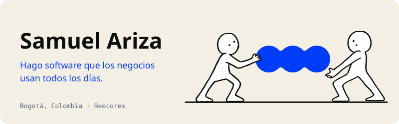
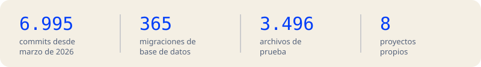

<a href="https://modari.app">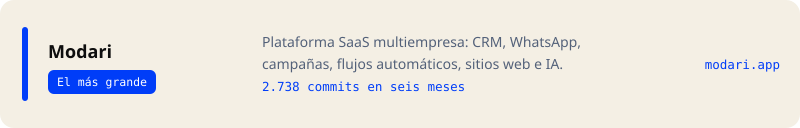</a>
<a href="https://tallerdelmaestro.com.co">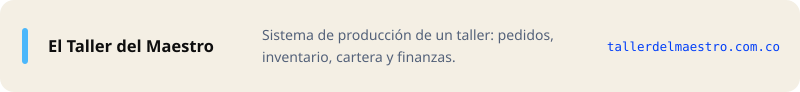</a>
<a href="https://sanaa.com.co">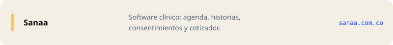</a>
<a href="https://bunker7.com.co">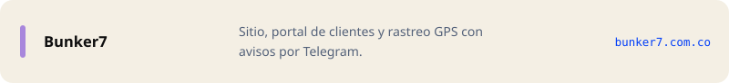</a>
<a href="https://iphoneshopbogota.com">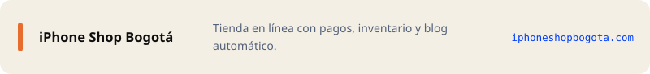</a>
<a href="https://modelari.com.co">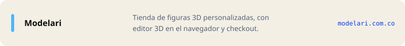</a>
<a href="https://beecores.com">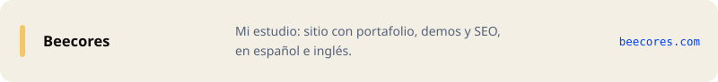</a>
<a href="https://dataplusmerchantservices.com">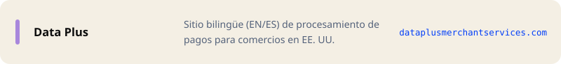</a>

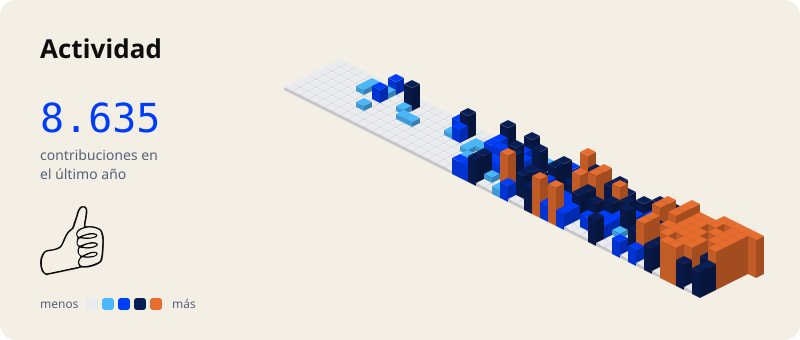

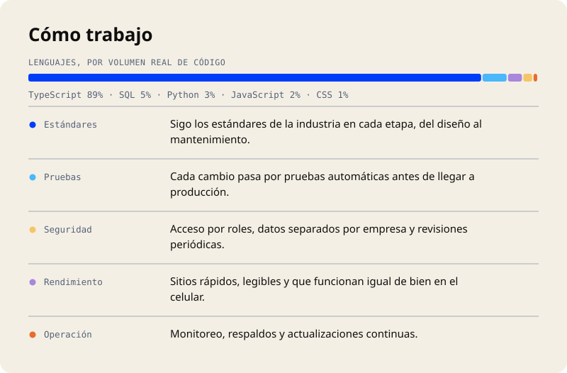

